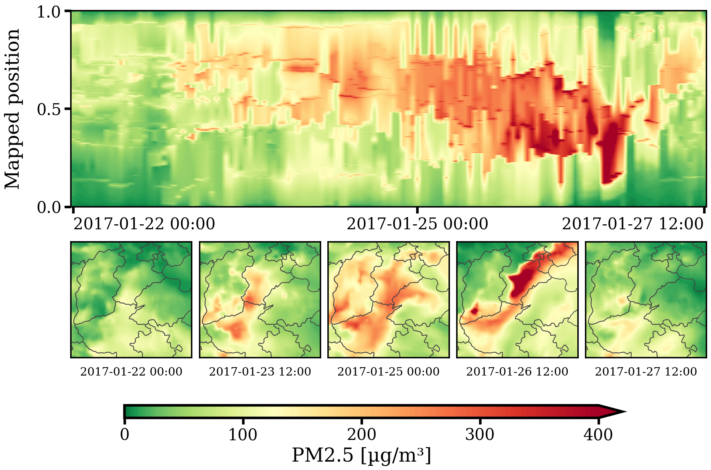

# AnchorMTM

Spatially anchored merge-tree maps for time-varying scalar fields, with topology budgets and certified position bounds.

## Current paper — November 8, 2026

- [Latest paper (PDF)](paper/pvis2027/最新论文与三张PPT/AnchorMTM_最新论文.pdf) · [LaTeX source](paper/pvis2027/drafts/method_anchor_figures_updated_en.tex)
- [Current figure index](paper/pvis2027/figures/FIGURE_INDEX.md) · [Paper and PowerPoint materials](paper/pvis2027/最新论文与配图PPT_20261107/)
- [Hourly PM2.5 case: figure, PowerPoint, plotting cache and checks](paper/pvis2027/pm25_hourly_20261107/README.md)
- [Formal four-input evaluation and provenance](paper/pvis2027/experiments_ratio_p_20261104/REPORT_zh.md)
- [Method and baseline code](code/) · [Data documentation](data/) · [Research documentation](docs/)

The revised manuscript presents the position bounds, construction and evaluation separately. Two-dimensional cases (Ring, Storms and hourly PM2.5) precede the exploratory three-dimensional Cylinder case. The new PM2.5 single-column figure places its temporal map above five source snapshots, with compact spacing and consistent date/time labels.

## Evidence and reproduction

The formal comparison uses Gaussian, Ring, Wildfires and Storms with disclosed local input conventions. Wildfires' local reconstruction is **not** the original author-processed 32-frame input. Published baseline scores and local measurements are distinguished; reconstruction differences limit identical-input claims.

The PM2.5 case uses the ChinaVis2021 CAQRA hourly archive for January 2017, with maxima handled as join trees of negated concentration. It is an additional exploratory case, reported as an additional fixed-configuration row in the results and parameter tables. The displayed window is January 22 00:00–27 12:00 (Beijing time), at a 5% layout allowance; persistence simplification is a separate parameter. Compact derived data and the replot script are included; nationwide source archives and large intermediate trees remain external.

[Paper build instructions and supporting material](paper/pvis2027/README.md). Historical reports and figure indexes describe earlier versions; the latest PDF and current case page above take precedence.

PM2.5 metrics are recomputed on all 744 shared-input frames: Balanced (fixed 5% case budget) has best SNS (0.1636) and NPE (0.0468); Exact has second NPE (0.1390). Hilbert has best TW (0.8887). Local ST-MTM uses the declared Storms preset with start frame 0; no author PM2.5 baseline scores are claimed. Uncached one-thread remeasurement gives optimization 199.975 s and full pipeline 231.177 s; scientific metrics exactly match the original run. Stage times are recorded in timing.json.

Latest layout revision: the former motion-reference and reference–topology-conflict schematic Figures 3–4 are removed from the manuscript. Subsequent figures are renumbered; the explanatory method text is retained. Historical figure assets remain archived.

Restored the overlap-based leaf-correspondence schematic in the correspondence section, using the archived [original PowerPoint](paper/pvis2027/最新论文与三张PPT/Fig3_跨帧特征对应.pptx). The previously removed direction/conflict figures remain omitted.

Latest synchronized version: the user-designated structure-revised manuscript, 10 pages, with the restored leaf-correspondence schematic and five-stage Cylinder source snapshots (including all vertical box edges). Figure numbering follows the current index rather than historical PowerPoint filenames.

Related-work schematic added as a single-column Figure 2, using the user-supplied PowerPoint with Times New Roman unified across all text. [PPT source](paper/pvis2027/最新论文与配图PPT_20261107/相关工作_拓扑映射_统一字体.pptx). The updated manuscript has 11 pages including references.

Added a single-column augmented-tree-to-1D mapping illustration and refreshed the related-work figure from the user-updated PowerPoint. Editable mapping PPT uses Times New Roman; the paper now embeds a direct screenshot of the original supplied mapping PPT, preserving its elbow connectors and geometry. The font audit documents that older raster-embedded labels are not yet all verified at the body-text size.

Mapping correction: replaced the redrawn version with a verbatim 3x rendering of the original user PPT. Font resizing is not applied to this figure, as requested.

The node-mapping diagram is now checked against the actual scalar filler: leaf intervals first, then LCA/internal paths, then root-path borders. Gray path samples can repeat; the 23-sample example independently preserves all pairwise leaf LCA levels. [Executable check](paper/pvis2027/figures/source/node_mapping_checked_20261108/verify.py). The original mapping screenshot is superseded by the checked native-PPT revision.
