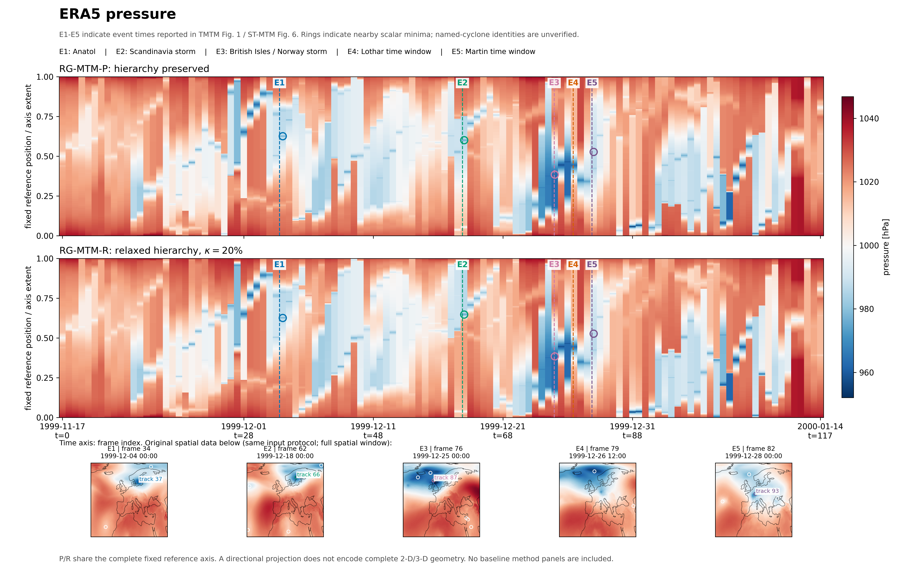
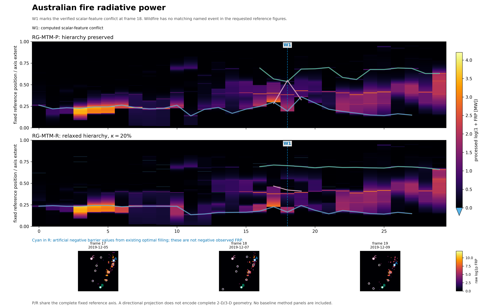
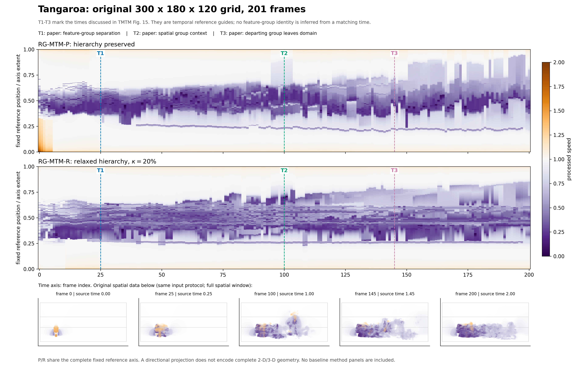

# RG-MTM 真实数据大图

按最新要求：只展示自己的 RG-MTM-P/R；参考论文的事件对应单独说明。

[三页 PDF 合集](rgmtm_large_figures.pdf) · [事件对应说明](event_correspondence_zh.md) · [English captions](captions_en.md)

## era5

[PDF](era5_rgmtm_large.pdf) · [SVG](era5_rgmtm_large.svg)

## wildfire

[PDF](wildfire_rgmtm_large.pdf) · [SVG](wildfire_rgmtm_large.svg)

## tangaroa

[PDF](tangaroa_rgmtm_large.pdf) · [SVG](tangaroa_rgmtm_large.svg)

