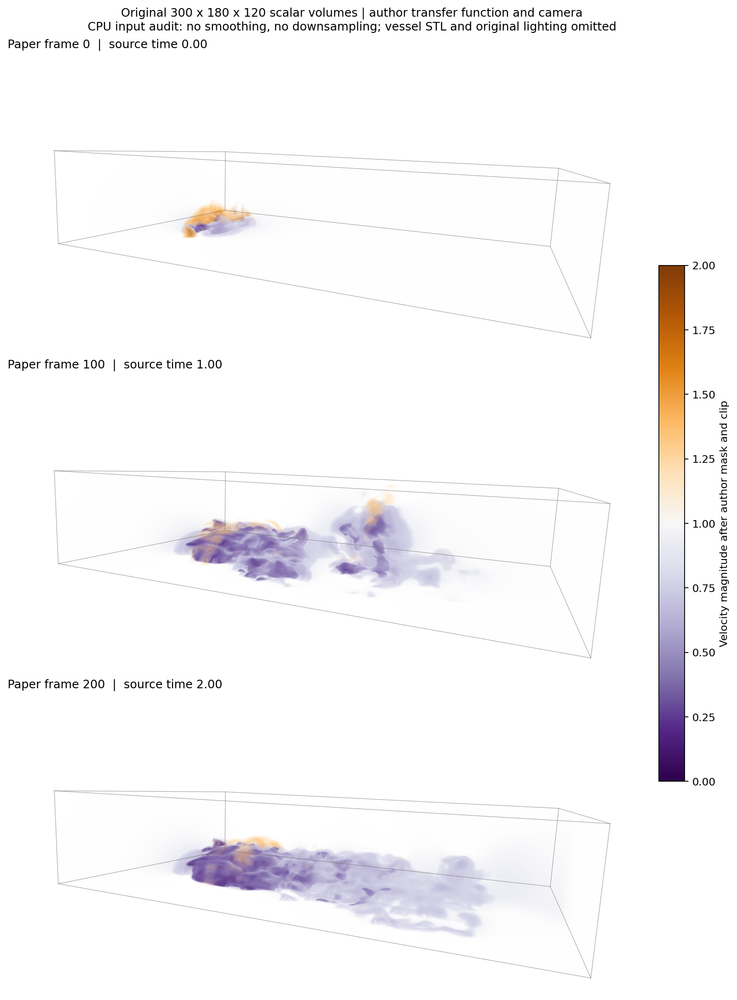

# Tangaroa 输入复核与旧实验更正（2026-10-18）

**核对结论：官方原始数据来源有充分一致性证据；此前 12 帧试跑的实际标量处理和树类型与作者公开工作空间不一致，不能作为论文图 15 的同输入复现或方法优劣证据。**

复核第一篇论文表 1、图 15，以及作者固定提交的工作空间、预处理器 C++ 和简化器源码。作者未公开其最终 Magnitude/*.dat 导出文件及校验和，因此不声称与这些未取得文件逐字节相同。

| 项目 | 论文／作者公开工作空间 | 此前官方 12 帧试跑 |
|---|---|---|
| 原始来源 | FAU Tangaroa，300×180×120×201 三分量速度 | 相同官方来源，仅使用前 12 帧 |
| 标量 | 速度模长 | 速度模长 |
| 近零处理 | 主工作空间将 abs(v)<1e-6 替换为 1 | 未替换 |
| 数值截断 | 真正修改标量到 [0,2]，并设置 data/value range | 未截断 |
| 树 | join tree（跟踪低值分支） | split tree（高值分支） |
| 空间网格 | 作者 Tangaroa 主处理链没有降采样或高斯平滑 | 抗混叠后降为 30×18×12，再 sigma=1 平滑 |
| 时间 | 全部 201 帧；图 15(b) 为编号 0、100、200 | 编号 0–11，对应物理时间 0.00–0.11 |
| 拓扑简化 | TTK 修改标量场；0.15%、0.5%、2%、10% 持久性阈值 | 复杂度驱动平滑；仅另做树上删叶诊断 |
| 三维图 | 体渲染，带非单调透明度传递函数 | 处理后数值最高 5% 的散点图 |

图 15 的四个持久性百分比与 RG 层次放松资格参数不是同一个量。按声明的 [0,2] 范围，四个名义绝对阈值为 0.003、0.01、0.04、0.2；公开主工作空间明确保存的是 0.2，不据此假定已取得全部四个最终简化输出。论文最强简化下仍有 50–186 个 supernodes，也不能与旧试跑每帧至多 6 叶的规模混为一谈。

## 本次实际完成的原分辨率核对

从官方 Amira 压缩包选取图 15(b) 的三个指定成员，逐一校验成员长度、CRC32、SHA256、Amira 空间头和轴序，在完整源网格计算 float32 速度模长，再按公开主工作空间作近零替换和截断。处理结果保存在本地 data/real/Tangaroa-FAU/paper_protocol_speed_index_*.npz。**这些是 TTK 简化前输入，不是已完成的合并树地图。**

| 论文帧号 | 官方文件 | 原始速度模长范围 | 替换为 1 的样本数 | >2 截断数 | 两工作空间 epsilon 导致的不同样本数 |
|---:|---|---:|---:|---:|---:|
| 0 | tangaroa-0.00.am | [0.0, 3.0590057373046875] | 13158 | 283 | 0 |
| 100 | tangaroa-1.00.am | [0.0, 1.597286343574524] | 13158 | 0 | 0 |
| 200 | tangaroa-2.00.am | [0.0, 1.4935719966888428] | 13158 | 0 | 0 |

第 0 帧速度模长最大值为 3.0590057373046875，与作者工作空间保存的原始最大值 3.0590057373046875 完全一致。这是标量通道和版本的一项强一致性证据，不能代替未公开导出文件的 SHA256。
物理范围直接读取源头：x=[-0.35,0.65]、y=[-0.3,0.3]、z=[-0.5,-0.3]；内存轴序 Z,Y,X,component，x 连续。三个成员均为 120×180×300×3，未裁剪空间域、未平滑、未降采样。

## 体渲染检查

使用作者独立体渲染工作空间的相机、传递函数节点和采样率 8；用 CPU 三线性采样、前向透明度合成产生输入检查图。作者体渲染工作空间的近零 epsilon 为 1e-9，主地图工作空间为 1e-6，差异样本数已在上表实际检查。绘图沿用主地图预处理结果。
CPU 参考渲染没有重现原 Blinn–Phong 光照。官方速度压缩包也不含作者路径中的 tangaroa.stl 船体网格，本图明确省略船体，不用拟造网格补齐。透明度步长修正采用归一化纹理距离约定，尚未核对作者编译版本的着色器。因此不能声称像素级复现，外观相似也不能替代输入校验。

## 对旧结论的处理

旧 tangaroa-official 目录的数组和指标保留为可追溯的粗网格 split-tree 试跑；其 NROE 0.287%→0、三维运动错误 14/14→2/14 等数字，**停止用于支持论文 Tangaroa 同输入比较**。旧源插值核验只证明代码忠实实现了旧协议，不能证明旧协议符合作者流程。ECNR VTM 备份同样不能替代论文速度模长输入。已同步更正结果索引、旧报告和写作说明。

尚未完成全部 201 帧的同设置 TTK 简化、join-tree 提取与完整 RG-MTM 布局，也未得到作者最终标量导出校验和。因此当前结论是“已纠正输入协议并完成指定三帧的原分辨率标量核对”，不能写为“论文图 15 或全序列实验已复现”。

## 证据与复核入口

- [逐帧源文件、处理计数与哈希](input_audit.json)
- [作者参数与源码哈希](author_settings.json)
- [生成文件校验和](artifact_hashes.json)
- [作者 Tangaroa 主工作空间](https://github.com/Wiebke/TemporalMergeTreeMaps/blob/2c75a10ed2cd55177a25ff751e0c0a8261200717/modules/mergetreemaps/data/workspaces/sequence_tangaroa.inv)
- [作者体渲染工作空间](https://github.com/Wiebke/TemporalMergeTreeMaps/blob/2c75a10ed2cd55177a25ff751e0c0a8261200717/modules/mergetreemaps/data/workspaces/sequence_tangaroa_volRendering.inv)
- [实际修改标量的预处理器](https://github.com/Wiebke/TemporalMergeTreeMaps/blob/2c75a10ed2cd55177a25ff751e0c0a8261200717/modules/tools/src/volumesequenceclampvaluerange.cpp)
- [FAU 官方数据页](https://www.vc.tf.fau.de/publications/datasets/)
- [旧粗网格试跑报告](../tangaroa-official/REPORT.md)
