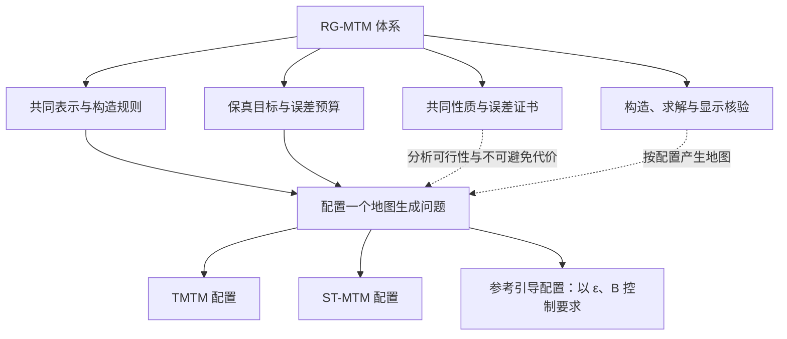
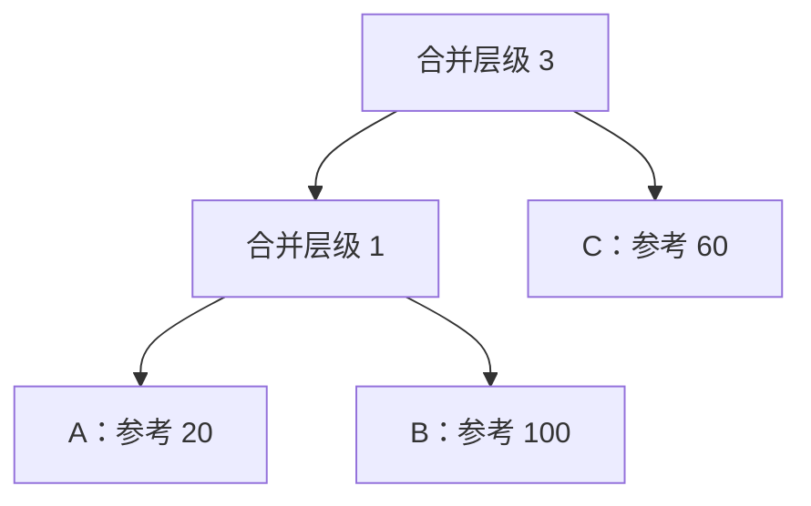
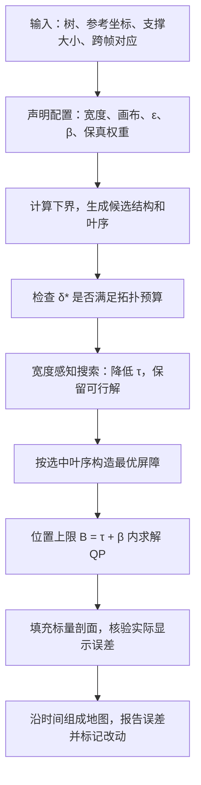

# RG-MTM 体系独立梳理

2026-10-28。依据当前 `paper/pvis2027/` 稿件，把其中的共同表示、实例映射、理论和算法重新组织为一套体系说明。本文展开概念，不直接改动论文正文。

## 1. RG-MTM 就是体系

**RG-MTM（Reference-Guided Merge Tree Maps，参考引导合并树地图）是整套体系的名称。**

共同表示、构造规则、保真目标、误差预算、理论证书以及构造与求解算法，都属于 RG-MTM。TMTM 和 ST-MTM 在其中由各自的配置表达；参考引导布局是体系支持的新配置。拓扑预算 ε 的不同取值是配置参数，不另立方法分支。

不要在层级图中再画一个与 TMTM、ST-MTM 并列、且也叫“RG-MTM”的子方法。横评中若用 RG-MTM 作为本文结果的简称，图注应说明它指体系的本文参考引导配置。

## 2. 体系解决的统一问题

输入是一段二维或三维标量场。每帧提取合并树，并保留特征的空间位置、支撑范围和跨帧对应关系。输出是“时间 × 一维位置”的地图：每帧变成一条标量剖面，再沿时间排开。

这个过程需要处理四种关系：

| 关系 | 具体问题 |
|---|---|
| 层级连接 | 哪些特征先连接，在什么标量值上连接？ |
| 相对几何 | 哪些特征相近，相距多少？ |
| 时间关系 | 特征怎样延续，怎样运动？ |
| 参考位置 | 一个特征在固定坐标轴上本应在哪里？ |

这些要求可能冲突。体系负责把要求表达清楚、判断能否同时满足，并在必要时限制和披露误差。

固定参考方向跨帧不变，参考坐标 q 随特征移动而变化。固定方向可以是东西向、流向，也可以是声明的其他一维参考。沿这一方向的坐标不包含被投影掉的其他空间信息。

## 3. 共同表示：一张地图有哪些可决定的对象？

将一帧地图展开为：

\[
M_t=(\pi_t,x_t,\mathcal I_t,b_t,\psi_t).
\]

| 对象 | 直观含义 | 它决定什么 |
|---|---|---|
| 叶序 π | 特征沿轴依次出现的顺序 | 谁在谁前面，哪些子树能连续 |
| 锚点 x | 极值在地图中的位置 | 特征画在哪里 |
| 区间 I | 分给特征或子树的一段空间 | 特征占多宽，能否容纳相邻特征 |
| 屏障 b | 相邻盆地之间的峰值；极大值情形采用取负后的约定 | 显示的合并层级 |
| 剖面 ψ | 最后画出的一维标量函数 | 颜色、盆地、屏障与层次的实际显示 |

参考坐标 q 是输入目标；锚点 x 是输出位置，两者不能混为一谈。区间宽度表达分配给特征的显示空间，也不等同于源场在参考方向上的实际投影宽度。

**叶序、位置和层级是三个相互关联的决定。** 给定叶序后，还要确定锚点和区间；给定锚点后，还要确定屏障；给定这些中间量后，还要检查填充出的剖面是否真的保留了对应关系。

## 4. 构造规则：共同语言怎样容纳不同方法？

用 `r` 表示构造规则，将现稿的合法布局集合展开写成：

\[
M_t\in\mathcal L_r(T_t).
\]

共同表示允许描述不同方法；r 则记录各自的约束、阶段、样本或弧对应关系，以及画布和归一化约定。

| 配置 | 必须保留的原生规则 |
|---|---|
| TMTM | 增强树的样本级线性化；给定原生分支决策后，按规定遍历生成样本位置和子树区间 |
| ST-MTM | 选叶序、优化几何骨架、优化包含锚点的特征区间，再层次填充 |
| 本文参考引导配置 | 声明画布、宽度、间距和锚点松弛；联合选择满足预算的叶序、屏障与位置 |

ST-MTM 按支撑大小确定目标宽度，再优化实际区间；本文区间配置使用声明的宽度规则。把所有配置都固定成本文的宽度、画布与锚点规则，会失去对原生方法的完整表达。

## 5. 保真目标和硬预算分别做什么？

### 5.1 目标表达偏好

\[
J=\sum_t\big[\lambda_OE_O+\lambda_GE_G+
\lambda_ME_M(\eta)+\lambda_RE_R+\lambda_WE_W\big].
\]

| 项 | 希望保留的内容 |
|---|---|
| E_O | 相邻帧源子树的重叠关系 |
| E_G | 锚点之间相对于源空间距离的几何关系 |
| E_M | 匹配特征的时间对齐或参考运动 |
| E_R | 锚点与固定参考坐标的接近程度 |
| E_W | 实际区间与目标宽度的一致程度 |

时间项可写成匹配特征上的平方残差：

\[
E_M(\eta)=\sum_{i\leftrightarrow j}
\big[(x_i^t-x_j^{t-1})-\eta(q_i^t-q_j^{t-1})\big]^2.
\]

η=0 希望显示位置尽量不变；η=1 希望显示位移跟随参考位移。两者分别表达稳定对齐和运动忠实。TMTM 的时间组织使用自己的子树重叠项 E_O，不能以这个锚点时间项替代后宣称恢复了原生 TMTM。

### 5.2 预算表达不可突破的限制

\[
d_{\mathrm{top}}(\psi_t,T_t)\le(\varepsilon_0+\varepsilon)\Delta_F,
\qquad
\max_i|x_i-q_i|\le B_t.
\]

- ε 是归一化的用户拓扑预算；Δ_F 是声明的标量范围。它限制任意叶子对的显示合并层级误差，不表示“允许修改 ε 比例的节点”。
- ε₀ 是数据精度容差；实验中的 ε=0 表示不额外花用户预算。严格的零误差定理和数值容差应分别解释。
- B_t 是位置单位下的位移上限；B_t/L 才是它占画布长度的比例。
- 权重表达“更希望怎样”，硬上限表达“最多允许怎样”。即使 λ_R=0，有限 B_t 仍会限制参考位移；η=1 也仍然使用参考运动。

对于固定输入和规则，增加预算会扩大可行集合。但某次启发式运行不一定找到更优解，各项几何、时间指标也不必同步改善。区间总宽度与间距超过画布时，单纯增大拓扑预算不能解决装箱不可行。

## 6. TMTM、ST-MTM 怎样作为体系中的配置？

完整配置可写为：

\[
\Theta=(r,\lambda,\eta,\varepsilon,B,\text{阶段组织}).
\]

体系定义问题 P(Θ)；相应算法 A_Θ 按该配置生成地图。通用目标提供共同记号，阶段组织保留原生过程，并不要求所有方法都一次性最小化同一个加权和。

| 配置 | 保真要求 | 预算 | 求解组织 |
|---|---|---|---|
| TMTM | 子树跨帧重叠 E_O | 精确拓扑，无参考位置上限 | 原生遍历与贪心分支调整 |
| ST-MTM | 相对几何与时间对齐，再分配宽度 | 精确拓扑，无参考位置上限 | 叶序选择 → 骨架 QP → 区间 QP |
| 本文参考引导配置 | 参考位置、相对几何、参考运动 | ε 和 B 显式声明 | 预算内排序 → 屏障构造 → 带位置上限的 QP |

原生算法可以是对应问题的启发式求解器。给定分支决策后恢复 TMTM 线性化，以及给定叶序后核验 ST-MTM 的 QP 条件，支持的是相应环节的实例映射；它们不等于证明整段序列被全局最优地求解。

## 7. 理论在体系中的位置：说明哪些要求不能同时满足

### 7.1 为什么拓扑会迫使位置出错？

在严格保持合并层级时，每个子树必须在一维剖面中连续成块。假如子树 {A,B} 的参考范围跨过另一个特征 C 的参考位置，那么 C 不能直接插进 A、B 之间。

排序下界来自这种共同约束，因此能分析 TMTM、ST-MTM 等精确拓扑配置。宽度感知下界还需要声明的区间模型条件，不能不加区分地套到所有构造规则上。

### 7.2 三个容易混淆的量

| 量 | 回答的问题 | 保证范围 |
|---|---|---|
| ν* | 所有合法顺序中，零宽度排序误差最低是多少？ | 精确拓扑的点模型排序问题有闭式最优解 |
| τ(π) | 固定一个顺序，考虑宽度、间距、画布和锚点松弛后，最小最坏位移是多少？ | 本文区间模型下该顺序的可达值 |
| δ*(π) | 固定一个顺序，最小可能的最大合并误差是多少？ | 固定极值值、可调整屏障的连续模型 |

ν* 不等于带宽度地图的实际最坏位移。τ(π) 也不自动等于所有顺序中的全局最优值。

## 8. 用一个三叶示例贯通顺序、位置和屏障

这是讲解用示例，不是论文真实数据。使用极小值约定：三个极值值均为 0，A、B 在层级 1 合并，再在层级 3 与 C 合并。

参考坐标 q_A=20、q_B=100、q_C=60，画布 [0,120]；每个区间宽 8，间距 2，锚点位于区间中心。此例忽略数值容差，β=0，仅最小化最坏位移。

**不放松时。** A、B 必须成块。选择顺序 A—B—C，可用锚点 20、75、85 达到最坏位移 25。两处屏障分别为 1、3，显示的三个点对合并层级均正确。零宽度排序代价为 20；宽度和间距将该顺序的最小代价增加到 25。

**允许绝对合并误差 1 时。** 顺序可以成为 A—C—B，三个锚点回到各自参考 20、60、100。两处屏障均取 2：A、B 的合并从 1 变成 2，其余两对从 3 变成 2，每一对误差均为 1。此例 Δ_F=3，对应归一化预算 ε=1/3。

所有特征都保留了，变化发生在显示的合并关系上。这个例子解释了：位置改善来自释放原来的连续块限制，代价由屏障误差精确计量。

## 9. 体系中的构造与求解过程

当前算法服务于参考引导配置，逐帧求解：

1. **准备固定参考。** 把极值位置投影到固定方向。支撑区域质心用于相对几何，极值位置用于参考坐标，两者角色不同。
2. **选择顺序。** 精确点模型可按子树参考范围中点排序；考虑宽度后，搜索更低的 τ。正预算时还生成展平和冲突驱动候选，每次都检查精确 δ*。
3. **确定屏障。** 固定叶序后，用最优屏障实现 δ*。选择性展平是候选生成手段，最终输出是否合格由实际误差判定。
4. **摆位。** 在 B_t=τ(π_t)+β 内优化参考、几何和时间项；实现中还含锚点偏心正则。τ 给出该顺序的最小可行上限，β 留出兼顾其他目标的余量。
5. **填充与披露。** 使用源弧样本填充剖面，并独立核验。当前稿标记超过 0.1% 标量范围的屏障变化，误差条报告实际拓扑误差；无标记不等于严格没有任何小改动。

中点排序和固定顺序的屏障问题有明确的最优结论；带宽度和预算的顺序搜索包含启发式。达到下界的输出可认证最优，未达到时应报告上下界差距。逐帧处理的时间项也不构成整段序列的全局最优保证。

## 10. 论文如何以体系为主线

建议顺序：**统一需求 → RG-MTM 体系 → 已有配置 → 共同限制与证书 → 参考引导构造与求解 → 实验和案例。**

实验分别检验三种能力：

- **表达能力**：原生构造和目标是否准确映射到体系配置？
- **解释能力**：共同证书能否说明不同配置的必要代价与取舍？
- **构造能力**：参考引导配置能否满足声明预算，给出有用的地图，并披露实际失真？

可以用这一段概括整篇工作：

> RG-MTM 是一个统一的合并树地图体系，通过共同表示、可配置的构造规则、保真目标和误差预算，组织层级、几何、时间与参考位置之间的关系。体系能够表达 TMTM 和 ST-MTM 的已有设计，并由共同约束推出位置代价的下界。在此基础上，本文给出参考引导配置的构造与求解过程，以声明的预算控制并披露地图失真。

## 源码对应

- 当前共同问题与实例表：`paper/pvis2027/main.tex`，Background and Problem。
- 当前算法与保证：同文件，Certified Bounds / Certified Layouts；`paper/pvis2027/supplement.tex`。
- 原生配置入口：`code/src/rgmtm/framework.py::native_profile`。
- 固定顺序合并代价、区间代价：`framework.py::merge_costs / interval_costs`。
- 点模型排序与预算候选：`code/src/rgmtm/order_certificate.py`。
- 宽度下界与搜索：`code/src/rgmtm/interval_order.py`。
- 原生方法实例核验：`code/experiments/instance_reproduction/README.md`。
