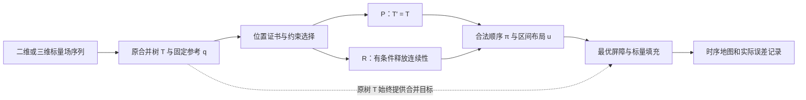

# PacificVis 2027 审稿视角：写作、配图与证据优先级

本建议依据 2026-10-23 的当前 `paper/manuscript/latex/main.tex` 递归输入、14 页正文 PDF、11 张正式图，以及当前证据边界文档。本文是修改方案，没有改写正文、图件、科学数组或实验协议。按用户最新要求，图片不设数量上限，也不以压缩到某个图数为目标。下文保留当前图号，新增图先用主题命名。

官方 Conference Paper Track 要求正文最多 9 页，另 2 页只能放致谢与参考文献；当前 PDF 第 13 页仍有正文。这是最终投稿版需要处理的篇幅要求，不是本轮限制图片梳理数量的理由。本轮先把完整论证及每图的必要性组织清楚。官方强调 originality、technical rigor、significance；正文应独立可理解，审稿人没有义务阅读补充材料。

官方来源：
- [Conference Paper Track](https://pacificvis2027.github.io/contribute/conference-papers/)
- [Paper Submission Guidelines](https://pacificvis2027.github.io/contribute/paper-submission-guidelines/)

## 1. 核心定位和可守住的贡献

建议按技术方法论文组织，围绕以下一句话展开：

> 子树连续性可能阻止特征贴近固定空间参考；RG-MTM 分离装箱与层次造成的位置代价，并计算给定顺序下最小的合并层级代价，使这项交换可以被检查。

现有标题 `Reference-Guided Merge Tree Maps: Quantifying Position–Topology Trade-offs` 与该定位一致。摘要和贡献不要继续扩展成“普遍更好地保持空间、运动与稳定性”。

三项贡献建议按“问题诊断—标量代价—可实现构造”排列：

1. 在明确的区间宽度、间隙、边界和锚点松弛模型下，给出固定顺序的位置成本与层次额外成本；冲突三元组解释阻碍来自哪里。
2. 在固定叶顺序、固定极值值的模型下，给出最优合并屏障和最小 labelled pairwise merge-level error；小树枚举得到精确可达前沿。
3. 将分析接入 P/R 两种地图构造，报告实际位置与标量误差，并用同输入比较、控制实验和源场对应案例检验收益及边界。

第三项不能只列数据集数量。前两项的创新性仍需对照最优叶序、区间布局、labelled cophenetic/interleaving 和有序瓶颈优化文献解释；本文建议不是新颖性认证。基本装箱、顺序搜索、ST-MTM 的路径填充等已知模块应明确归属。

## 2. 审稿人最可能提出的质疑

| 质疑 | 当前材料中的触发点 | 优先回应 |
|---|---|---|
| 是否只是 ST-MTM 加参考位置项？ | 原有工作已同时处理拓扑、距离和时序；固定参考自然提高其对应指标 | 明确 certificate 与 fixed-order optimal filling 的独立结果；考虑补一个仅向 ST-MTM 加固定参考项的最小改动对照 |
| 评价是否只奖励自身优化目标？ | 正文以 NROE 为中心；NROE 不等于实际坐标误差 | 并列实际锚点位移；将已有标准指标和简单排序控制的关键结论提到正文 |
| 标量改动是否足以改变物理解读？ | Storms 平均 NMLE 1.47%，最大 26.07%；OLR 最大 33.56%；Tangaroa 平均 14.442%、最大 31.021% | 同时呈现均值与最坏帧；案例直接标出原连接阈值与输出阈值；解释 P/R 如何选择 |
| “控制误差”是否为硬保证？ | κ 是 eligibility threshold；大树仅有限候选搜索 | 使用“量化/报告交换”的表述；κ、实际 δ、持久性必须分开；写明精确结果适用范围 |
| 三维比较是否完整？ | Tangaroa/Cylinder 没有 ST-MTM；3D 仍被压成 1D 位置 | 现有结果可支持体数据适用性；若主张优于 ST-MTM，补同输入 3D 对照；保留 exact projection 作为投影损失参照 |
| 案例是否只是更多图？ | Nucleon、Benzene、Tangaroa、Cylinder 分别占图；容易重复同一个收益 | 每图对应独立论点：无放松收益、静态截面、大树体输入、低代价及饱和；不因图数预先删图 |
| 是否证明了读者更容易理解？ | motion 为计算对应上的几何代理，无参加者实验或物理轨迹真值 | 主张限定为计算诊断；若保留读者表现主张，则需要独立任务研究 |

已有标准指标不能被忽略：`standard_metric_checks.tex` 明确 RG-R 在 Storms、OLR、PM2.5 的 SNS、TW、TD 均不如 ST-MTM。正文应主动说明目标取舍，完整结果留附录。已有 Kendall/Spearman、三分类 BA/F1 是额外计算证据，不能称为用户研究。

### 投稿前需明确的最近邻理论关系

| 工作 | 与当前主张的关系 | 应写清的区别 |
|---|---|---|
| [Chepoi & Fichet, l∞-Approximation via Subdominants (2000)](https://www.sciencedirect.com/science/article/abs/pii/S0022249699912701) | 给出subdominant与最优L∞近似的一般关系；当前refs.bib已有该条目，但当前TeX中未见讨论或引用 | 检查最优屏障中C+δ与该框架的关系，哪些是专门化，固定叶值、固定顺序及与显示几何共同实现前沿增加了什么；未完成该比较前不能认证公式全新 |
| [Aliyev & Zirbel, Seriation using tree-penalized path length (2023)](https://www.sciencedirect.com/science/article/pii/S037722172200501X) | 已将路径长度与树结构违例惩罚组合，在TSP与OLO之间过渡 | 本文使用绝对参考q，而非仅相邻路径长度；计算实际合并层级改动，而非仅树违例惩罚，不能声称首次放松层次换空间改善 |
| [Chepoi & Seston, L∞ fitting Robinson structures (2009)](https://drops.dagstuhl.de/entities/document/10.4230/LIPIcs.STACS.2009.1816) | 与顺序兼容的距离矩阵近似有关 | Robinson结构一般类与路径最大值对应的顺序兼容合并结构不同，需具体说明关系，不能直接认定等价或无关 |

这些是需要主动回应的相邻研究，并不构成“已经证明重复”的结论。最值得补的理论段落应解释本文模型的附加约束与已有近似框架之间的数学关系，而不是增加笼统的“首次”措辞。

## 3. 不预设图数的论证大纲

| 章节 | 必须回答的问题 | 建议内容与图表 |
|---|---|---|
| 1 Introduction | 哪类分析需要固定空间参照？为什么层次与参照会冲突？ | 图1；具体分析任务；一个三叶冲突；三项贡献 |
| 2 Related Work | 与 TMTM、ST-MTM、参考排序、树比较的具体差别是什么？ | 最近邻方法比较；补充树惩罚排序与subdominant近似的关系 |
| 3 Background and Problem | T、T′、ψ、q和区间约束各做什么？ | 图2；贯穿全文的A/B/C例子；输入、目标和可行域 |
| 4 Position–Topology Analysis | 哪些位移与标量代价无法避免？ | τ与H；冲突三元组；固定叶值最优屏障；小树前沿；完整证明另附 |
| 5 RG-MTM Construction | 如何从诊断得到P/R地图？ | 图3总流程；图4机制；顺序选择、区间布局、填充、误差输出 |
| 6 Quantitative Evaluation | 理论是否兑现？简单方法能否替代？代价多大？ | 图5及必要机制消融；新增总体比较图；图6控制；实际误差和标准指标 |
| 7 Source-linked Case Studies | 改善与错误分别对应源场什么结构？ | Storms、Wildfires、Nucleon/Benzene、Tangaroa、Cylinder各有不同论证任务 |
| 8 Discussion and Limitations | 何时用P/R？投影、标量修改和求解有什么边界？ | 无收益/高代价结果；方向和几何取舍；有限候选搜索 |
| 9 Conclusion | 解决了什么明确问题？ | 回答核心问题，不再列完整数据集清单 |

图3可以在第4节开始前作为总览浮动图，也可以在第5节开头出现；图4随最优填充解释出现。尽量保持前四图的主体与编号，不需为理论先于方法而打乱现有图序。第4节的关键定义须用直观文字和A/B/C例子引入，不能把读者直接带入大段符号。

第6节按证据组织，而不是按数据集组织：

- E1 位置诊断：H 是否真实存在，装箱和层次各贡献多少？
- E2 标量机制：相同顺序下 optimal filling 是否优于原 LCA filling？
- E3 同输入比较：保留层次的 P、释放约束的 R、TMTM/ST-MTM、简单排序分别处于什么位置？
- E4 绝对参考控制：距离保持为什么不能确定固定位置？
- E5 计算与稳健性：保留特征数/分支度、证书界、端到端代价、方向/参数敏感性。

## 4. 图1—4保留，后续每图承担不同论点

本表沿用当前编号，后续新增图插入后再统一编号；保留不意味着所有图都不改，也不意味着各数据集必须使用相同布局。

| 当前图 | 建议 | 读者应确认的结论 | 具体补强 |
|---|---|---|---|
| Fig1 Storms 744小时 | 保留teaser主体 | 固定参考下的全时段摘要能关联源场与局部特征 | 精简过长图注；明确744小时独立于主统计。局部可加低对比参考线，分清q与u；不把计算track写成独立确认的气旋身份 |
| Fig2 TMTM/ST-MTM | 保留主体 | 前人已处理层次/距离/时序，但仍有连续性约束 | 单栏实际字号可读；一句话指出本文新增问题；保留示意出处 |
| Fig3 RG-MTM流程 | 保留五阶段 | 从输入、诊断到地图的完整连接关系 | T/T′分流，P/R分支，原树T直连filling；详见下一节 |
| Fig4 三叶机制 | 保留主体 | 同一放松叶序下，最优填充减少合并误差 | 保持A/B/C颜色；γ/2例子的极值条件写清；一般定理保留固定叶值项 |
| Fig5 五序列前沿 | 保留并重构统计口径 | 位置改善的可达边界与标量价格 | 区分逐帧案例与跨帧聚合；标注2013/14是独立历史序列；不要把不同聚合的点线距离说成求解gap |
| Fig6 镜像控制 | 保留，突出目标区别 | 距离关系不能唯一确定绝对参考位置 | 保留三方法；加全序列仿射校准误差；写明全部零NMLE，不把该例当作放松必要性的证据 |
| Fig7 Wildfires | 保留并补齐局部证据 | P中的跳动有布局成分；R改善位置有具体标量代价 | 同期基线局部条带、q/u参考、帧17—19源位置、原/输出barrier、共享色标和人工负值标记 |
| Fig8 Nucleon | 可保留，承担无收益边界 | 并非每个输入都需要放松；P/R相同 | 加TMTM对照或一个小表，说明P为何足够；不要将单帧结果写成时间/三维验证 |
| Fig9 Benzene | 可保留，承担静态截面扩展 | 静态相邻截面上的参考一致性与改变的连接 | 使用z坐标；加有差别的局部与数字，避免只放两张看似相同的蓝色地图；明确重建电势模型 |
| Fig10 Tangaroa | 保留独立三维主案例 | 较大体输入中冲突机制与实际成本可追溯 | 原网格、固定方向；frame140局部q/u和连接误差；保留有解释力的体视图；给求解界而非仅像素数 |
| Fig11 Cylinder | 保留独立三维案例 | 低代价工作点与放松收益饱和 | 在现有地图/体图旁加P/R2/R20/R100工作点；同一NROE下R100有更高标量代价，不只放R20 |

建议新增的图应先补缺失证据，数量由清晰度决定：

- **总体比较图**：覆盖六序列同输入TMTM/ST-MTM/P/R及简单参考排序。可用位置改善—合并成本工作点，配实际锚点误差；已有SNS/TW/TD的得失不能只用一个综合分数盖过。
- **证书与填充消融图**：packing/H分解；固定同一叶序下LCA与optimal的配对NMLE。若与Fig5放一起过密，拆成独立图，分别证明诊断和填充。
- **Storms同输入真实局部对照图**：从118帧评价序列取已有源场—TMTM—ST-MTM—P—R对应案例；解释地理顺序改善与压力连接阈值变化。它与744小时teaser是不同角色，不混统计。
- **误差尾部/方向/规模图**：只有在回答独立质疑时单独出图。用完整逐帧记录展示高代价频率；方向图说明固定方向的依赖；规模图分开诊断与完整流水线耗时。没有必要把这些强拼成一张大图。

推荐的读图链是：展示能力（图1）→前人目标（图2）→完整构造（图3）→三叶机制（图4）→理论与消融（图5及新增机制图）→总体比较（新增）→绝对参考控制（原图6）→真实时序案例（Storms局部、原图7）→无收益与静态扩展（原图8—9）→三维机制及工作点（原图10—11）→必要稳健性证据。

Fig5特别注意：当前前沿曲线使用共同标量预算下的跨帧平均位置成本，绿点把平均位置最优值与跨帧最大标量成本配在一起。两者聚合不同，不能把点线距离当成求解次优差距。339/342指选定顺序按自身成本接近逐帧前沿，也不是最终多目标地图全局最优。

Fig6特别注意：该控制说明绝对位置与距离目标不同，并不意味着ST-MTM距离目标失败；三方法在该例全部保留合并层级。

Cylinder的工作点值得保留：P为NROE12.262%/mean NMLE0；R2为0.249%/0.692%；R20为0.084%/2.810%；R100为0.084%/3.190%。展示完整关系比仅挑R2更有说服力，也避免事后按各数据集选最优参数。

## 5. 流程图的具体修改

保持现Fig3五阶段，模块名建议：

1. Scalar-field sequence：二维场/三维体为输入，沿用同一特征身份色。
2. Topology and fixed reference：上轨道为原树 T，下轨道为固定方向 d 与参考 q；支持量、宽度与匹配在这里定义。
3. Diagnose and choose constraints：显示 τfree、τ*、H；P直接令T′=T；R在H触发且节点满足κ时释放连续性。二维恢复剪枝与三维有限搜索的协议差异放图注/正文。
4. Layout and optimal filling：先从T′确定合法顺序π与实际位置u；再以原树T的合并值为目标求屏障，并完成标量填充。
5. Temporal map and error record：时序图、实际位置误差、合并层级误差，以及大树尚未闭合的证书区间。

必须让两条信息流在图上分清：T′决定哪些顺序合法；T始终决定需要比较的源合并值。否则容易被误读为先改树、再对改后的树报告零误差。κ应连到可放松节点，不应画成输出误差上限。

参考方向d和归一化在整段序列中固定，不可画成逐帧随动坐标。概念图的特征身份色与结果图的物理标量色是两套语义，应保留图注解释。

## 6. 提高中稿把握的行动优先级

### 必须先做：聚焦和呈现现有证据

1. 先完成完整论证与图件职责梳理，图数不限；最终投稿版再按9+2页规范实排，必要时迁移完整协议与重复展示，保留关键机制与负结果。
2. 重写摘要和贡献：先讲参考—层次冲突，再讲两项可证明分析，最后给一组清晰收益/代价。删去摘要中的静态数据集清单。
3. 将 Packed Sort 与固定同序填充消融的关键结果提到正文。已有Storms简单排序NROE=0但平均NMLE=6.18%，RG-R为1.47%；这比再加一个应用图更能说明为何需要选择性释放。
4. 将已有标准指标的关键取舍、一个秩相关/三分类结果摘要提到正文；不隐去ST-MTM的SNS/TW/TD优势。
5. 两套独立总体及不同分母继续分开：342帧中含Storms118帧；744小时teaser、64帧控制、Tangaroa201体、Cylinder102体、Nucleon单帧、Benzene21截面不能累计成一个总样本量。
6. 正文保留mean/max NMLE，并在图7或8标记局部原始/输出合并阈值。Wildfires负连接是构造值，需要直接标识。

### 最值得新增的证据

1. 最小改动基线：ST-MTM+fixed-reference，仅增加同一参考目标，尽可能保留其顺序/填充协议，公开权重和计算预算。它直接回应“加位置项是否足够”。若与RG-P近似，应承认P是整合，突出证书及最优屏障的贡献。
2. 3D ST-MTM同输入对照：如果要宣称三维上优于最近邻方法，应补足。若只做固定规则选取的代表帧，须明确只是部分对照；不能把部分运行写成全201/102帧结果。未补时，三维主张限定为可用性和所报告TMTM/P/R比较。
3. 实际输出代价审计：利用已有逐帧记录，给出高代价帧比例或分位数，以及少量阈值解释。先统一解析值、连续锚点值和最终栅格值，不能静默混用。
4. 端到端计时：分开提取、诊断、候选布局、填充；报树叶数和分支度。现有4096叶3.604s只支持诊断模块速度，不能推到整个流水线。

固定方向、持久性和窗口敏感性已有材料，优先整理，不先重复跑。数据拟合方向是离线构造的一部分，不是留出测试上的预测；若要比较方向，预先确定规则并说明选择来源。

### 用户研究何时值得做

以分析/算法贡献投稿时，用户研究不是本建议的必做补丁。若要声称“读者更准确理解运动/更快发现事件”，则应设计相应研究：源场作为真值、预先定义任务、方法顺序平衡、独立参加者、报告效应与不确定性。少量专家反馈可以解释用法，不能代替性能研究。当前最优先的是补对照、明确标量价格和压缩论证链。

## 7. 引言与案例可直接套用的写作顺序

引言六段：
1. 固定位置比较这一具体任务；
2. TMTM/ST-MTM各自解决什么；
3. 一个A/B/C三叶冲突，说明布局变动与源运动会混在一起；
4. 给定顺序要牺牲什么合并阈值这一问题；
5. certificate、optimal filling、P/R方法概览；
6. 三条可验证贡献及有限的结论范围。

案例统一四步：分析问题 → 源场证据 → 地图改变 → 支付的标量代价。例：Wildfires中C参考位置固定，P锚点跳动；R减少该布局残差，但将A/B连接改为人工负值。让读者同时看到收益与代价，避免把更平滑的图当作全部证据。

可用的英文核心定位：

> We quantify the positional obstruction imposed by hierarchical contiguity under a fixed spatial reference, and compute the minimum labelled merge-level distortion for a chosen leaf order.

可用的范围说明：

> Reference alignment improves the intended positional correspondence; geometric and temporal quality depend on the selected reference and the structures retained by projection.

## 8. 提交前两周的建议顺序

按当前源码标注的2027 Conference Track，官方摘要截止为2026-11-02、全文为2026-11-09（均23:59 AoE；分别对应北京时间11-03、11-10的19:59）。摘要注册与全文上传是两个步骤。

- 10月23—26日：定核心主张、贡献和论证大纲；逐张确认现有图及新增图的证据职责，不预设图数。
- 10月27—30日：先补最关键基线/证据审计；将已有标准指标、简单排序和填充消融提到正文；重构图5—8。
- 10月31日—11月2日：完成一版可独立审读的正文和摘要注册；让不了解项目的人只读正文，检查能否说清新意、收益、代价。
- 11月3—6日：修复审读指出的证据断点；核验统计口径、图注、单位与正文数字。
- 11月7—9日：实排检查9+2页、完整PDF可读性、匿名信息、稳定补充材料及复现入口；预留上传时间。

这份计划优先解决可导致拒稿的论证缺口，不预测录用概率。最终科学主张必须以实际完成且可追溯的证据为准。
