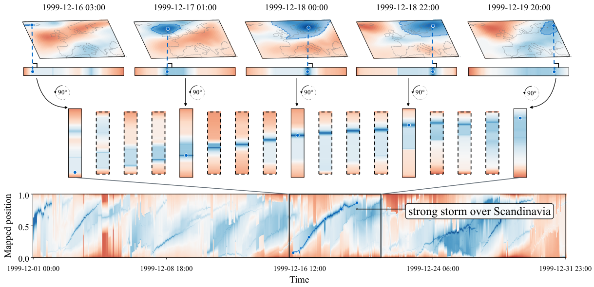
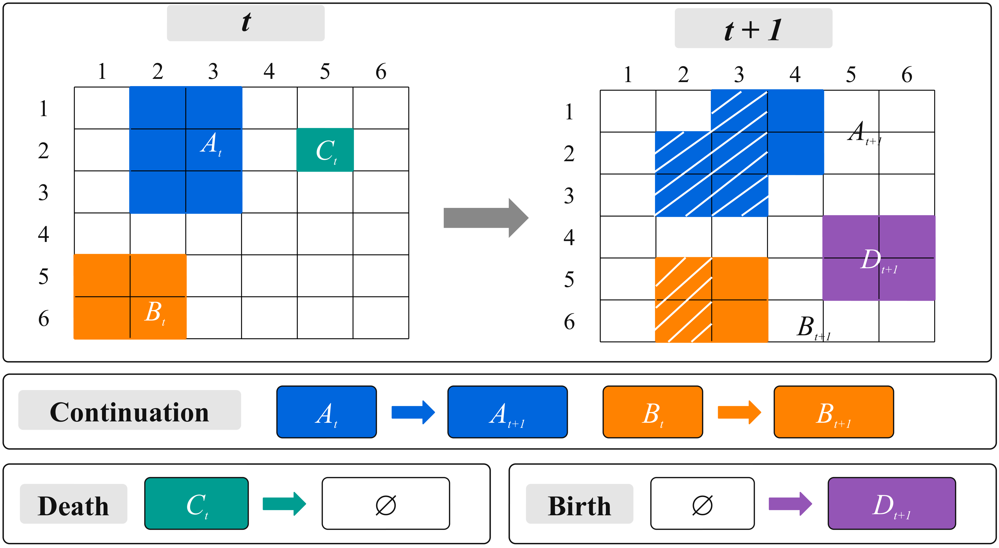
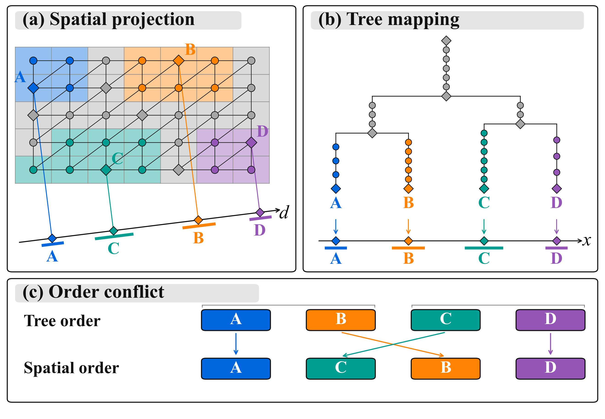

# 当前正文三张图

正文来源：[PDF](../最新论文与三张PPT/AnchorMTM_最新论文.pdf) · [LaTeX](../drafts/method_anchor_figures_updated_en.tex)。

## Figure 1 — Storms overview

[PDF](anchor_storms_overview.pdf) · [PNG](anchor_storms_overview.png) · [可编辑 PPT](../最新论文与三张PPT/Fig1_Storms.pptx)

## Figure 2 — Cross-frame leaf correspondence

[PDF](anchor_leaf_correspondence.pdf) · [PNG](anchor_leaf_correspondence.png) · [可编辑 PPT](../最新论文与三张PPT/Fig2_跨帧特征对应.pptx)

## Figure 3 — Spatial projection and hierarchy conflict

[PDF](anchor_projection_conflict.pdf) · [PNG](anchor_projection_conflict.png) · [可编辑 PPT](../最新论文与三张PPT/Fig3_空间映射与拓扑冲突.pptx)

Figure 3 的论文版去掉小编号以适应单栏；PPT 保留完整编号。宽度是示意，非定量结果。

当前图 2、3 已统一为 Times New Roman、灰色标题底和黑框；字号按正文内的实际大小校准。图 3(c) 包括各色块黑框。
