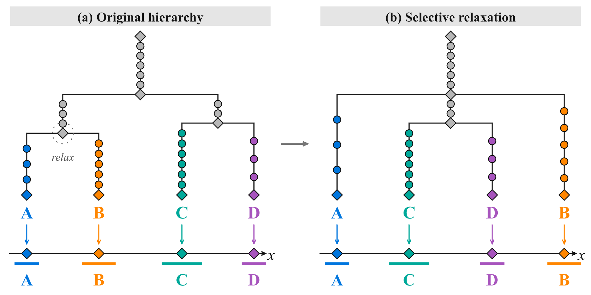
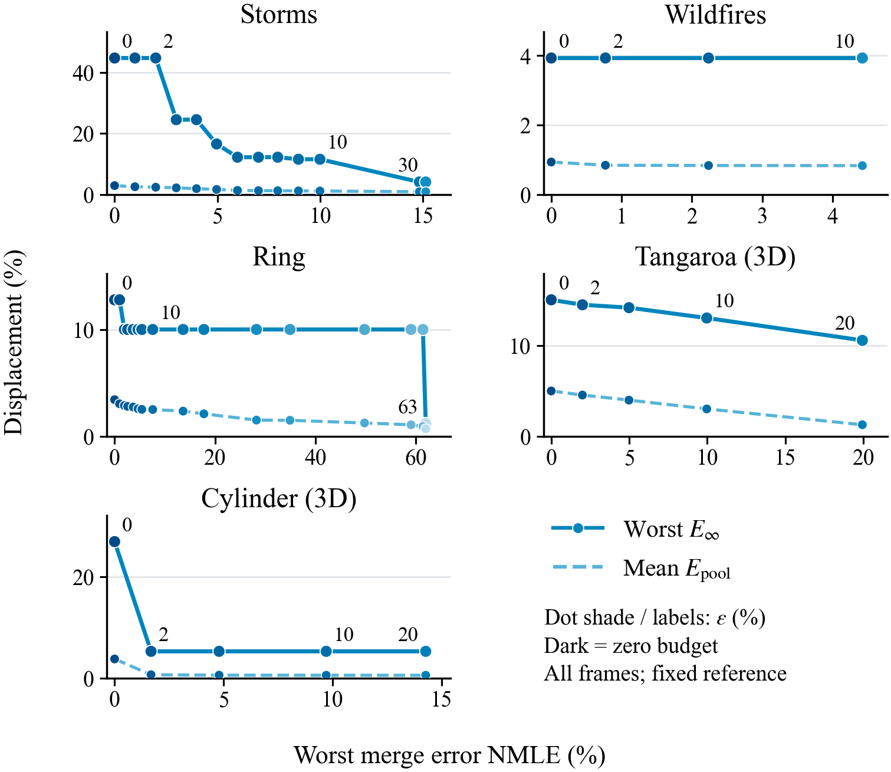

# 当前正文五张图

正文来源：[PDF](../最新论文与三张PPT/AnchorMTM_最新论文.pdf) · [LaTeX](../drafts/method_anchor_figures_updated_en.tex)。

## Figure 1 — Storms overview

[PDF](anchor_storms_overview.pdf) · [PNG](anchor_storms_overview.png) · [可编辑 PPT](../最新论文与三张PPT/Fig1_Storms.pptx)

## Figure 2 — Cross-frame leaf correspondence

[PDF](anchor_leaf_correspondence.pdf) · [PNG](anchor_leaf_correspondence.png) · [可编辑 PPT](../最新论文与三张PPT/Fig2_跨帧特征对应.pptx)

## Figure 3 — Spatial projection and hierarchy conflict

[PDF](anchor_projection_conflict.pdf) · [PNG](anchor_projection_conflict.png) · [可编辑 PPT](../最新论文与三张PPT/Fig3_空间映射与拓扑冲突.pptx)

Figure 3 的论文版去掉小编号以适应单栏；PPT 保留完整编号。宽度是示意，非定量结果。

当前图 2、3 已统一为 Times New Roman、灰色标题底和黑框；字号按正文内的实际大小校准。图 3(c) 包括各色块黑框。

## Figure 4 — Selective relaxation

[PDF](anchor_selective_relaxation.pdf) · [PNG](anchor_selective_relaxation.png) · [可编辑 PPT](../最新论文与三张PPT/Fig4_选择性放松.pptx)

单栏机制示意图，非实验结果。

## Figure 5 — Position--topology trade-offs

[PDF](anchor_budget_tradeoff_single_column.pdf) · [PNG](anchor_budget_tradeoff_single_column.png) · [可编辑 SVG](anchor_budget_tradeoff_single_column.svg)

单栏五子图：Storms、Wildfires、Ring、Tangaroa (3D)、Cylinder (3D)；第六格用于共用图例。Gaussian只从本图删除。Storms/Wildfires各14点、Ring21点，Tangaroa/Cylinder各5点。横轴为渲染后实际最坏NMLE；实线为最坏位移E∞，虚线为所有特征—帧平均位移Epool（不是NPE）。二维沿用正式实验；三维为独立核验的完整渲染档案，采用各自冻结参考与预处理，不替换四数据集主表。正文第8页。当前脚本和59个配置的绘图数据位于paper/pvis2027/budget_tradeoff_20261105；三维1515列的固定叶标签完整矩阵（含对角线）均通过预算检查。没有加入未计算的投影星号或同模型基线框。
